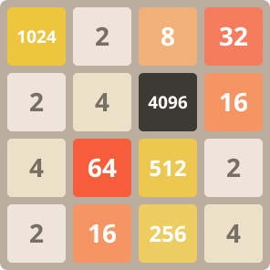
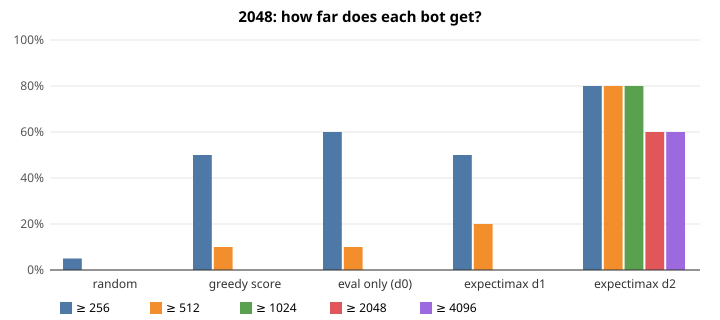

# 🔢 2048 - 기대값 탐색(Expectimax) 에이전트

[](https://colab.research.google.com/github/Lee-hosuk/game-agent/blob/main/2048/game_2048.ipynb)

4×4 판에서 타일을 밀어 같은 숫자끼리 합치고 **2048 타일**을 만드는 게임입니다.
사람의 전략을 담은 **평가 함수**와, 랜덤으로 나오는 새 타일의 평균을 계산하는 **Expectimax 탐색**으로 에이전트를 만들었습니다.

<p align="center"></p>
<p align="center">깊이 2 에이전트가 2,734수 만에 4096 타일을 만든 판</p>

## 사목과 뭐가 다를까?

| | 사목 (Connect Four) | 2048 |
|---|---|---|
| 상대 | 나를 이기려는 **상대** | 랜덤으로 나오는 **새 타일** |
| 상대 차례 계산 | 나에게 **가장 불리한** 수 (min) | 모든 경우의 **평균** (기대값) |
| 탐색 | 미니맥스 / 알파-베타 | **Expectimax** |

## 구현한 것

### 1. 평가 함수: 사람의 전략을 점수로
2048 고수들의 전략인 **"큰 타일은 구석에, 뱀 모양으로 줄 세우기, 빈칸 많이 남기기"**를 점수로 바꿨습니다.
칸마다 가중치를 정하고 `타일 숫자 × 가중치`를 더한 뒤, 빈칸 하나마다 보너스를 줍니다.

```
가중치 (2의 거듭제곱)        뱀 모양 경로
 2¹⁵  2¹⁴  2¹³  2¹²         →  →  →  ↓
 2⁸   2⁹   2¹⁰  2¹¹         ↓  ←  ←  ←
 2⁷   2⁶   2⁵   2⁴          →  →  →  ↓
 2⁰   2¹   2²   2³              ←  ←  ←
```
같은 타일들이라도 뱀 모양으로 정리된 판은 **11,224,320점**, 흩어진 판은 **889,106점**이 나옵니다.

### 2. Expectimax 탐색
- **내 차례 (max)**: 4방향 중 값이 가장 큰 방향을 고름
- **새 타일 차례 (chance)**: 빈칸마다 2가 나올 경우(90%)와 4가 나올 경우(10%)를 모두 계산해 **확률로 가중 평균**
- **깊이**: 몇 수 앞까지 내다보는지 (한 수 = 내가 밀기 + 새 타일 등장)

| 깊이 | 내다보는 범위 | 살펴본 판 수 (예시 판) |
|:-:|---|--:|
| 0 | 밀어본 결과만 평가 (탐색 없음) | 0 |
| 1 | 밀고 → 새 타일의 모든 경우 | 72 |
| 2 | 밀고 → 새 타일 → 또 밀고 → 또 새 타일 | 4,662 |
| 3 | 한 수 더 | 285,684 |

## 결과



| 에이전트 | 판 수 | 최고 타일 |
|---|:-:|---|
| 랜덤 | 20 | 대부분 64~128 (최고 256) |
| 점수 욕심 (당장 점수가 가장 큰 방향) | 20 | 대부분 128~256 (최고 512) |
| 평가 함수만 (깊이 0) | 10 | 128~256 (최고 512) |
| Expectimax 깊이 1 | 10 | 128~512 |
| **Expectimax 깊이 2** | 5 | **4096 × 3판**, 1024 × 1판, 128 × 1판 |

- 평가 함수만 써도 랜덤보다 나아지지만, **새 타일의 평균까지 두 수 앞을 내다봐야** 판이 막히는 상황을 피해서 2048을 넘어갑니다.
- 깊이 2 에이전트는 한 판에 2,000수 넘게 두고, 코랩 CPU에서 한 판에 10~30초 정도 걸립니다.
- 새 타일이 랜덤이라 깊이 2도 초반에 운 나쁘게 막히는 판이 있습니다 (128에서 끝난 1판).

## 그 밖의 기능
- **경기 GIF**: 깊이 2 에이전트의 한 판을 GIF로 저장합니다.
- **직접 해보기**: 노트북 9번 셀에서 ↑←↓→ 버튼으로 직접 두고, **🤖 AI 추천 / 🤖 AI가 한 수 / ⏩ AI 20수** 버튼으로 도움을 받을 수 있습니다.

## 배운 점
- 상대가 "적"이 아니라 "운"일 때는 최악의 경우(min)가 아니라 **기대값(평균)**으로 판단해야 한다.
- 사람이 쓰는 전략을 **평가 함수로 옮기는 것**만으로도 AI가 크게 좋아진다. 하지만 그것만으로는 부족하고, 충분히 앞을 내다봐야 한다.
- 처음에는 깊이가 얕아서(512에서 막힘) 평가 함수가 문제인 줄 알았지만, 실제로는 **탐색 깊이가 부족한 것**이 원인이었다.
