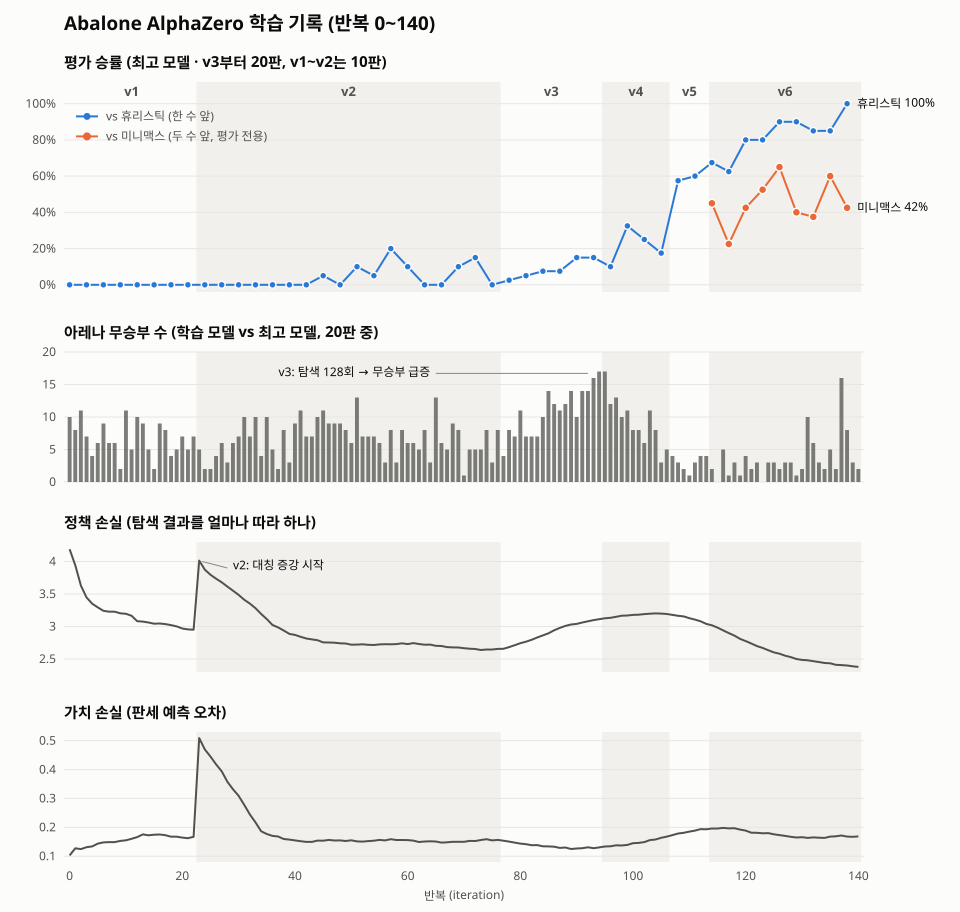

# Abalone AlphaZero Agent

육각형 판에서 구슬을 밀어내는 보드게임 **아발론(Abalone)**을 **ResNet + MCTS 자기대전(AlphaZero 방식)**으로 학습하는 에이전트입니다.
Google Colab 무료 GPU(T4)에서 돌아가도록 만들었습니다.

## 학습 방식

```
① 자기대전 → ② 리플레이 버퍼 → ③ 학습 모델 훈련 → ④ 아레나 대결 → ⑤ 교체 여부 결정 → ①
```

1. **자기대전**: 현재 최고 모델끼리 MCTS(수당 64회 탐색)로 64판을 두며 (국면, 탐색 방문 분포, 최종 결과)를 기록
2. **리플레이 버퍼**: 최근 15만 국면 보관
3. **학습**: 정책(탐색 분포 따라 하기) + 가치(승패 예측) 손실로 400스텝 학습
4. **아레나**: 학습 모델 vs 최고 모델 20판 (흑백 교대)
5. **교체**: 55% 이상 이기면 최고 모델 교체, 아니면 유지하고 학습 계속

### v2 개선 (반복 22회 시점, 휴리스틱 상대 0% 정체 대응)
- **가치 목표 개선**: `0.5 × 승패 + 0.5 × (떨어뜨린 구슬 차이 / 6)` — 200수 판정 승패만으로는 신호가 거칠어서, 구슬 차이를 함께 반영
- **대칭 데이터 증강**: 육각판의 12가지 회전·반사를 학습 샘플마다 무작위 적용 (규칙 보존 검증 완료)
- 신경망 구조는 동일해서 v1 체크포인트를 그대로 이어서 학습
- 결과: 반복 45회에 휴리스틱 상대 승률이 처음 0%를 벗어나고(5%), 57회 20%

### v3 개선 (반복 76회 시점, 정책손실 2.65 근처 정체 대응)
- **계단식 학습률**: `lr_schedule = {0: 1e-3, 75: 3e-4, 150: 1e-4}` — 이어서 학습할 때 저장된 옵티마이저의 예전 학습률을 설정값으로 덮어씀
- **MCTS 탐색 64 → 128회**: 자기대전 정답지 품질 향상 (반복 시간 약 2배)
- **평가 판 수 10 → 20**: 휴리스틱 상대 승률 측정 오차 감소
- 결과: 가치손실은 0.154 → 0.133으로 개선됐지만, 무승부가 급증(아레나 20판 중 12~14무)하고 정책손실이 2.66 → 2.94로 상승 — 자기대전이 서로 피하기만 하는 소극적 플레이로 수렴하는 신호. 휴리스틱 상대 2~8%

### v4 개선 (반복 86회 시점, 소극적 플레이 대응)
- **휴리스틱 대국 섞기**: 자기대전의 25%(`heuristic_frac`)를 휴리스틱 봇과 두고, AI 쪽 국면만 학습 데이터로 사용
- 매 반복 "자기대전 vs휴리스틱" 성적(16판) 출력
- 무승부 페널티(양쪽 모두 감점)는 검토 후 제외: 부호를 뒤집는 MCTS 백업 구조에서는 "상대의 감점 = 나의 가점"이 되어 오히려 무승부를 유도함
- 결과(반복 95~105회): 정식 평가 휴리스틱 승률은 10~15% → 18~33%로 개선, 아레나 무승부도 감소. 그러나 자기대전 중 휴리스틱 판은 6회 연속 0%, 가치손실 0.145 → 0.164로 상승 — 연습판에서 AI가 초반 30수를 무작위로 두다 시작부터 밀리는 판만 쌓이는 문제

### v5 개선 (반복 105회 시점, 휴리스틱 연습판 개선)
- 휴리스틱 판에서는 AI 초반 무작위를 4수로 줄이고(`heuristic_temp_moves`) 탐색 잡음을 끔(`heuristic_noise=False`) — 실전에 가까운 대국에서 배우도록
- 순수 자기대전 판(75%)은 그대로 유지해 다양성 확보
- 결과(반복 107~109회): 자기대전 vs휴리스틱 0% → 50~69%, 정식 평가 휴리스틱 승률 18~25% → 57%, 아레나 무승부 2~4무로 감소. 연습판 0%는 실력 부족이 아니라 초반 무작위 때문이었음

### v6 개선 (반복 109회 시점, 평가 전용 미니맥스 봇)
- 휴리스틱 봇과 직접 두며 배우므로 휴리스틱 승률이 "그 봇 맞춤 실력"일 수 있어, 학습에 쓰지 않는 평가 전용 상대를 추가
- **미니맥스 봇**: 같은 점수표로 2수 앞(내 수 → 상대 최선 응수)까지 읽음, 알파 가지치기로 수당 약 5ms. 휴리스틱 상대 12판 11승 1무
- 3번마다 20판 평가, 출력과 그래프에 `vs미니맥스` 추가

### 학습 반복 수 100 → 200
- 반복 100회 시점에도 휴리스틱 상대 승률이 10~15%에 머물러, 100회로는 부족하다고 판단해 `iterations`를 200으로 늘림 (체크포인트에서 이어서 학습)

## 구성

| 구성 요소 | 내용 |
|---|---|
| 게임 환경 | 61칸 육각판(축 좌표), 직선 이동·옆걸음·밀어내기(스모) 규칙, 시작 합법수 44개 검증 |
| 행동 공간 | 직선 이동 366 + 옆걸음 2196 = 2562 |
| 신경망 | ResNet (64채널, 잔차 블록 6개), 정책 헤드 + 가치 헤드 |
| 입력 | 9×9×6 (내 구슬, 상대 구슬, 유효 칸, 잃은 구슬 수 ×2, 진행도) |
| 탐색 | PUCT 기반 MCTS, 여러 판의 잎 노드를 묶어 GPU 배치 평가 |
| 종료 조건 | 구슬 6개 떨어뜨리면 승리, 200수 도달 시 떨어뜨린 수로 판정 |
| 비교 상대 | 랜덤 에이전트, 휴리스틱 에이전트(한 수 앞 탐욕: 떨어뜨리기 > 중앙 > 뭉치기), 미니맥스 에이전트(평가 전용, 2수 앞) |

## 실행 방법

1. `abalone_alphazero.ipynb`를 Google Colab에서 열기
2. `런타임 → 런타임 유형 변경 → T4 GPU` 선택
3. `모두 실행` → 구글 드라이브 연결 허용
4. 체크포인트는 `MyDrive/abalone_az/`에 반복마다 저장되며, 세션이 끊겨도 다시 실행하면 이어서 학습

학습 후에는 **11번 셀에서 판을 클릭해서** AI와 둘 수 있습니다 (1~6번 → 11번 실행, 저장된 `best_model.pt`를 자동으로 불러옴). Colab 밖에서는 10번 셀(번호 입력 방식)을 쓰세요.

## 결과

반복 0~140회(약 1주일, Colab 무료 T4 GPU, 반복당 6~13분)까지 학습한 결과입니다.

### 최종 성적 (반복 138회 정식 평가, 각 20판)

| 상대 | 승률 |
|---|---|
| 랜덤 | 100% |
| 휴리스틱 (한 수 앞) | 100% (최근 4회 평가 85~100%) |
| 미니맥스 (두 수 앞, 평가 전용) | 42% (최근 5회 평가 38~65%, 평균 약 50%) |

### 버전별 흐름

| 구간 | 버전 | 휴리스틱 상대 | 미니맥스 상대 | 무슨 일이 있었나 |
|---|---|---|---|---|
| 0~22 | v1 | 0% | – | 200수 판정 승패만으로는 학습 신호가 너무 거칠었음 |
| 23~76 | v2 | 0% → 20% | – | 대칭 증강 + 구슬 차이 가치 목표로 45회부터 0% 탈출 |
| 77~94 | v3 | 2~15% | – | 탐색 128회로 늘리자 무승부 급증(아레나 20판 중 14~17무), 소극적 플레이로 수렴 |
| 95~106 | v4 | 10~33% | – | 휴리스틱 대국 섞기로 무승부는 감소, 그러나 연습판은 0% |
| 107~113 | v5 | 57% | – | 연습판을 실전처럼 두게 하자 연습판 0% → 50~69% |
| 114~140 | v6 | 62% → 100% | 22~65% | 평가 전용 미니맥스 추가, 휴리스틱·미니맥스 승률이 함께 오르다가 미니맥스 50% 근처에서 정체 |

### 사람과 둬본 결과

- 구슬을 뭉쳐 가운데를 차지하는 기본 전략은 확실히 익혔음
- **마무리가 약함**: 상대 구슬 하나만 더 떨어뜨리면 이기는 상황에서 끝내지 않고 진형만 정비함
  - 원인: 200수 판정승이 있어서 "지금 6개째를 떨어뜨려 이기는 것"(가치 약 0.92)과 "5:1로 버티다 판정승"(약 0.83)의 차이가 작고, 자기대전에서 마무리 장면을 거의 겪지 못함

### 배운 점

- 승패만 주는 거친 보상보다 **구슬 차이 같은 촘촘한 신호**가 초반 학습에 결정적이었음
- 탐색을 깊게 하면 오히려 **서로 피하기만 하는 무승부**로 수렴할 수 있음 → 공격적인 상대(휴리스틱)를 섞어 해결
- 연습 상대와 둘 때 탐험용 무작위성이 너무 크면 **의미 없는 패배만 쌓임** → 연습판은 실전처럼
- 학습에 쓰는 상대의 승률은 과적합될 수 있어서 **학습에 안 쓰는 평가 전용 상대**(미니맥스)가 필요함
- "비기면 양쪽 감점"은 부호를 뒤집는 MCTS에서 오히려 무승부를 유도함



## 다음에 해볼 것

- **마무리 능력**: 구슬 6개로 이긴 판은 가치 1.0, 200수 판정승은 지금처럼 구분 / 한 수로 이길 수 있으면 바로 두기
- 미니맥스 정체 대응: `heuristic_frac` 0.25 → 0.1, 학습률 3e-4 → 1e-4
- 연습 상대를 2수 미니맥스로 바꾸고, 평가는 3수 미니맥스로
- 벨지안 데이지 등 다른 시작 배치로 무승부 줄이기
- numba로 게임 로직 가속
