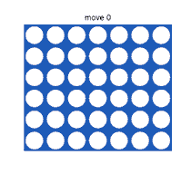
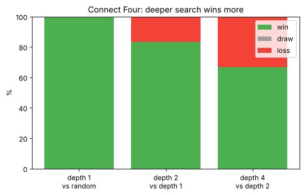

# 🔴🟡 사목 (Connect Four) - 알파-베타 탐색 에이전트

7칸 × 6줄 판에 위에서 돌을 떨어뜨려, **가로·세로·대각선으로 4개**를 먼저 잇는 쪽이 이기는 게임입니다.
체스·바둑의 고전 AI가 쓰는 **깊이 제한 탐색 + 평가 함수 + 알파-베타 가지치기**를 직접 구현했습니다.

알파-베타 깊이 4(🔴) vs 깊이 2(🟡)

## 틱택토와 뭐가 다를까?

| | 틱택토 | 사목 |
|---|---|---|
| 판 크기 | 3 × 3 | 7 × 6 |
| 가능한 판 상태 | 약 6천 개 | 약 4조 5천억 개 |
| 미니맥스로 끝까지 계산 | 가능 | **불가능** |
| 해결 방법 | 전부 계산 | **몇 수 앞까지만 보고 판을 점수로 어림잡기** |

## 구현한 것

### 1. 평가 함수
게임이 끝나지 않은 판에 점수를 매깁니다. 판의 모든 **4칸 구간 69개**를 살펴봅니다.

| 4칸 구간 상태 | 점수 |
|---|---|
| 내 돌 3개 + 빈칸 1개 | +5 |
| 내 돌 2개 + 빈칸 2개 | +2 |
| 상대 돌 3개 + 빈칸 1개 | −4 |
| 가운데 열의 내 돌 1개마다 | +3 |

이기면 아주 큰 점수(+1,000,000)에 **남은 깊이만큼 보너스**를 더해서, 같은 승리라도 빨리 이기는 수를 고르게 했습니다.

### 2. 깊이 제한 미니맥스
정해진 깊이까지만 내려가고, 거기서 평가 함수로 점수를 매깁니다.
내 차례에는 점수가 가장 높은 수, 상대 차례에는 나에게 가장 불리한 수를 고른다고 가정합니다.

### 3. 알파-베타 가지치기
"어차피 선택되지 않을 수"는 끝까지 보지 않고 잘라냅니다.
- **alpha**: 내가 지금까지 확보한 최고 점수
- **beta**: 상대가 지금까지 허용한 최저 점수
- `alpha ≥ beta`가 되면 나머지 수는 볼 필요가 없음

가운데 열부터 살펴보도록 순서를 정해서, 좋은 수를 일찍 찾고 더 많이 잘라내게 했습니다.

## 결과

### 미니맥스 vs 알파-베타
같은 판, 같은 깊이에서 고른 수와 점수는 **완전히 같고**, 살펴본 판의 개수만 줄어듭니다.

| 깊이 | 미니맥스 | 알파-베타 | 줄어든 비율 | 시간 |
|:-:|--:|--:|:-:|:-:|
| 2 | 56 | 56 | 0% | 0.01초 → 0.01초 |
| 3 | 399 | 225 | 44% | 0.05초 → 0.03초 |
| 4 | 2,716 | 833 | 69% | 0.41초 → 0.14초 |
| 5 | 18,934 | 3,633 | **81%** | 2.67초 → **0.39초** |

깊이가 1 늘 때마다 미니맥스의 판 수는 약 7배씩 늘어나지만, 알파-베타는 훨씬 완만하게 늘어납니다.
그래서 같은 시간에 **더 깊이** 볼 수 있습니다.

### 깊이에 따른 실력 (리그전)

| 대결 | 판 수 | 승 / 무 / 패 |
|---|:-:|:-:|
| 깊이 1 vs 랜덤 | 10 | 10 / 0 / 0 |
| 깊이 2 vs 깊이 1 | 12 | 10 / 0 / 2 |
| 깊이 4 vs 깊이 2 | 12 | 8 / 0 / 4 |

더 깊이 볼수록 강해집니다. 선공/후공을 번갈아 바꿨고, 같은 깊이끼리는 거의 같은 수를 두기 때문에 판 수가 적으면 선공 유리함에 크게 좌우됩니다.
(6판만 뒀을 때는 깊이 4 vs 깊이 2가 3승 3패로 나와서 12판으로 늘렸습니다. 실행할 때마다 결과는 조금씩 달라질 수 있습니다.)

## 그 밖의 기능
- **LLM 플레이어**: `google.colab.ai`(Gemini)로 LLM에게 판을 글로 보여주고 열을 고르게 해서, 알파-베타 에이전트와 대결시킵니다.
- **직접 대결**: 노트북 10번 셀에서 `↓1`~`↓7` 버튼으로 알파-베타(깊이 조절 가능) 또는 LLM과 둘 수 있습니다.

## 배운 점
- 경우의 수가 너무 많은 게임은 끝까지 계산하는 대신, **몇 수 앞까지만 보고 평가 함수로 어림잡는** 방식으로 충분히 강한 AI를 만들 수 있다.
- 알파-베타 가지치기는 **결과를 바꾸지 않고** 계산량만 줄인다. 탐색 순서(가운데부터)에 따라 잘라내는 양이 달라진다.
- 실력 비교는 판 수가 적으면 운에 크게 좌우된다. 결론을 내기 전에 충분히 여러 판을 둬야 한다.
