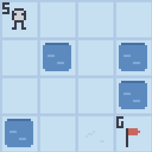
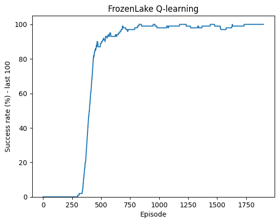

# 🧊 FrozenLake - Q-러닝 직접 구현

[](https://colab.research.google.com/github/Lee-hosuk/game-agent/blob/main/frozenlake/frozenlake.ipynb)

얼음판 위에서 구멍(H)을 피해 시작점(S)에서 선물(G)까지 가는 게임입니다.
PPO 같은 라이브러리 없이 **Q-러닝 알고리즘을 NumPy로 직접 구현**했습니다.

```
S F F F      S: 시작   F: 얼음(안전)
F H F H      H: 구멍(빠지면 실패)
F F F H      G: 선물(도착하면 성공, 보상 +1)
H F F G
```

## 학습 전 vs 학습 후

| 학습 전 (랜덤) | 학습 후 |
|:---:|:---:|
|  |  |
| 성공률 **0%** (100판) | 성공률 **100%** (100판) |

## 학습 곡선



처음에는 epsilon이 커서 대부분 랜덤으로 움직이며 길을 탐색합니다.
epsilon이 줄어들면서 Q-테이블을 따르는 비율이 늘고, 약 800판부터 성공률이 거의 100%에 도달합니다.

## 학습된 정책

칸마다 Q값이 가장 높은 방향입니다. 구멍을 피해 최단 경로로 G에 도착합니다.
```
 ↓  →  ↓  ←
 ↓  H  ↓  H
 →  ↓  ↓  H
 H  →  →  G
```

## 원리: Q-러닝

**Q-테이블**은 "이 칸에서 이 방향으로 가면 앞으로 얼마나 좋을까?"를 적어두는 16칸 × 4방향 점수표입니다.
매 스텝마다 아래 식으로 점수를 고칩니다.

```python
target = reward + gamma * max(Q[next_state])
Q[state, action] += alpha * (target - Q[state, action])
```

- G 바로 옆 칸부터 점수가 생기고, 판을 거듭할수록 점수가 **한 칸씩 뒤로 번져** 시작점까지 전달됩니다.
- 한 칸 멀어질 때마다 `gamma`(0.95)배씩 줄어들기 때문에 G에서 가까운 칸일수록 점수가 높습니다.
  (예: 14번 칸 1.00 → 13번 0.95 → 9번 0.90 → 8번 0.86 …)
- 식의 형태는 오차 `(target - Q)²`에 대한 **경사하강법**과 같습니다.
  다만 target 안에 Q 자신이 들어 있어(부트스트래핑) 과녁이 계속 움직인다는 점이 다릅니다.

## 학습 설정

| 설정 | 값 | 의미 |
|---|---|---|
| `alpha` | 0.8 | 학습률. 예상이 빗나간 만큼 얼마나 크게 고칠지 |
| `gamma` | 0.95 | 할인율. 미래 보상을 얼마나 중요하게 볼지 |
| `epsilon` | 1.0 → 0.01 | 탐험 확률. 판마다 0.995를 곱해 줄임 |
| `episodes` | 2,000 | 총 플레이 판 수 |
| `is_slippery` | False | 미끄러지지 않는 얼음 (누른 방향으로 정확히 이동) |

## CartPole(PPO)과 비교

| | FrozenLake (Q-러닝) | CartPole (PPO) |
|---|---|---|
| 상태 | 칸 번호 16개 (셀 수 있음) | 실수 4개 (무한히 많음) |
| 배운 것을 저장하는 곳 | 표 (16 × 4) | 신경망 |
| 구현 | 직접 구현 | 라이브러리 사용 |

## 배운 점
- `model.learn()` 한 줄 안에서 일어나는 일(행동 선택 → 결과 관찰 → 점수 업데이트)을 직접 구현해 보았다.
- 보상이 도착 순간에만 주어져도, Q값이 뒤로 전파되면서 시작점에서의 행동까지 평가할 수 있다.
- Q-러닝 업데이트 식은 경사하강법과 같은 형태이며, 표를 신경망으로 바꾸면 DQN이 된다.
