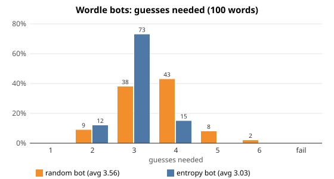

# 🟩🟨⬜ LLM 워들 에이전트

[](https://colab.research.google.com/github/Lee-hosuk/game-agent/blob/main/llm-wordle/llm_wordle.ipynb)

5글자 영어 단어를 **6번 안에** 맞히는 게임입니다. 추측할 때마다 글자별로 힌트가 나옵니다.
🟩 글자도 자리도 맞음 · 🟨 있는 글자지만 자리가 틀림 · ⬜ 없는 글자

같은 문제를 **LLM**과 **정보 이론 봇**에게 풀게 하고, **힌트를 코드로 정리해서 알려주면** LLM이 얼마나 좋아지는지 실험합니다.
코랩에 내장된 `google.colab.ai`(Gemini)를 사용해서 API 키 없이 실행할 수 있습니다.

## 틱택토 LLM과 뭐가 다를까?

| | 틱택토 | 워들 |
|---|---|---|
| 판단 근거 | **지금 판**만 보면 됨 | **지난 힌트 전부**를 기억하고 종합해야 함 |
| 필요한 능력 | 한 수 고르기 | 여러 조건을 동시에 만족하는 단어 추론 |
| 흔한 실수 | 이미 찬 칸 고르기 | 없다고 나온 글자를 또 쓰기, 5글자가 아닌 단어 |

## 구현한 것

### 1. 힌트 계산
같은 글자가 여러 번 나오는 경우를 처리합니다. 정답이 `ABIDE`일 때 `SPEED`를 넣으면, 정답에 `E`가 하나뿐이라 **첫 번째 E만 🟨**이고 두 번째 E는 ⬜입니다.
① 먼저 🟩를 표시하고 ② 남은 글자 개수만큼만 🟨를 줍니다.

### 2. 비교용 봇
- **🎲 랜덤 후보 봇**: 지금까지의 힌트와 맞는 단어 중 아무거나 고름
- **🧠 정보 이론 봇**: 후보를 **가장 많이 줄여줄** 단어를 고름. 단어마다 나올 수 있는 힌트 모양별로 후보가 몇 개씩 남는지 세고, **엔트로피**(평균 정보량)가 가장 큰 단어를 고릅니다. 첫 단어로는 `ALERT`(5.86비트)를 고릅니다.

### 3. LLM 플레이어
두 가지 프롬프트를 비교합니다.
- **기본 프롬프트**: 규칙과 지금까지의 추측·힌트만 보여줌
- **정리 프롬프트**: 코드가 힌트를 미리 정리해서 함께 알려줌

```
힌트를 정리하면:
- 확정된 자리: C H A R T
- 정답에 없는 글자 (쓰지 마): E I L N
```

LLM은 글을 글자 단위가 아니라 **토큰**(단어 조각) 단위로 읽어서 "3번째 글자가 뭐지?" 같은 걸 자주 틀립니다. 정리 프롬프트는 이 약점을 코드가 메워주는 방식입니다.
LLM의 실수도 따로 셉니다.
- **형식 오류**: 5글자 영어 단어가 아님 → 이유를 알려주고 다시 물어봄
- **힌트 무시**: 이미 없다고 나온 글자를 쓰는 등, 지금까지 힌트와 맞지 않는 단어를 냄

## 결과

### 봇 (정답 후보 547개 중 100문제)



| 봇 | 맞힌 문제 | 평균 추측 횟수 |
|---|:-:|:-:|
| 🎲 랜덤 후보 | 100 / 100 | 3.56번 |
| 🧠 정보 이론 | 100 / 100 | **3.03번** (73문제를 3번 만에) |

정답 후보가 547개로 적어서 랜덤 후보 봇도 꽤 잘 맞힙니다. 정보 이론 봇은 4번 넘게 걸린 문제가 하나도 없습니다.

### LLM (기본 vs 정리 프롬프트)
노트북 9번 셀에서 같은 10문제를 두 프롬프트로 풀게 하고 **맞힌 비율, 평균 추측 횟수, 형식 오류, 힌트 무시 횟수**를 비교합니다.
(실행 결과는 추후 추가 예정)

## 그 밖의 기능
- **LLM 한 판 지켜보기**: LLM이 어떤 생각으로 단어를 골랐는지 출력합니다.
- **직접 해보기**: 노트북 10번 셀에서 단어를 입력해서 직접 풀 수 있고, 막히면 **🧠 봇 추천** 버튼으로 정보 이론 봇의 추천을 받을 수 있습니다.

## 배운 점
- 워들은 숫자야구처럼 **힌트로 후보를 좁혀가는 추리 게임**이고, "후보를 가장 골고루 쪼개는 추측"이 정보 이론적으로 가장 좋은 수다.
- 이 노트북에는 **학습이 없다.** 정보 이론 봇은 후보를 직접 다 계산하고, LLM은 이미 학습된 모델에 프롬프트로 물어볼 뿐이다.
- LLM이 약한 부분(글자 단위 추론, 여러 조건 동시에 따지기)은 **코드가 정리해서 넘겨주는** 식으로 보완할 수 있다. 실제 LLM 에이전트도 이렇게 도구와 함께 쓴다.
